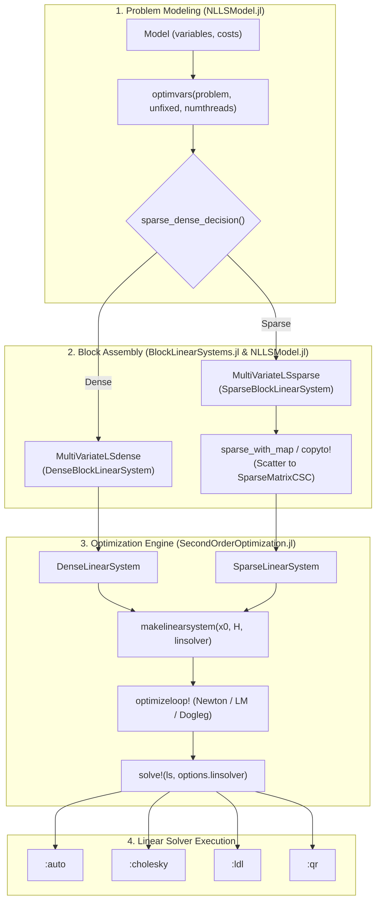

# Linear Systems and Solvers Architecture: Technical Review, Code Audit, and Roadmap

> **Ecosystem Context & Scope**: `NLLSsolver.jl` is **deprecated** and maintained strictly as a backwards-compatibility wrapper. Active development and core algorithms reside in:
> - **`SecondOrderOptimization.jl`** (commit `522f7a4`): Optimization engine (Newton, Levenberg-Marquardt, Dogleg, Gradient Descent), linear solver abstractions, and concrete backends.
> - **`NLLSModel.jl`** (commit `9564ef5`): Factor-graph problem formulation (`Model`), robust cost/residual blocks, autodiff, block sparsity extraction, and the `optimvars` optimizer bridge.
> - **`BlockLinearSystems.jl`** (commit `be3bcdc`): Block-structured contiguous memory layouts, block accessors, and zero-allocation scatter operations.
> - **`OptimizationVariableInterface.jl`**: Manifold variable traits and retraction/update interfaces.

---

## 1. System Pipeline & Dataflow

The decoupled architecture separates problem modeling from linear system assembly and iterative optimization:



The standard user workflow directly connects `NLLSModel.jl` and `SecondOrderOptimization.jl`:
```julia
using NLLSModel, SecondOrderOptimization

problem = Model(...) # construct factor graph
f, fdf!, x0, H = optimvars(problem)
x_opt, result = optimize(f, fdf!, x0, OptimizationOptions(iterator=:levenbergmarquardt); H=H)
```

---

## 2. Current Implementation and Solver Dispatch

### A. Linear System Selection

Selection is handled in `NLLSModel.jl/src/optimize.jl` via `optimvars_dispatch`:

1. **Single-Variable Optimization (`unfixed::Integer` or single unfixed block)**:
   - If dimension $D = \text{nvars}(x_0)$ is static and $D \le 16$:
     - Uses `UniVariateLSstatic_x{D}` and `UniVariateLSstatic_ls{D, D^2}`.
     - Bridges via `makelinearsystem` to `StaticLinearSystem{D, D^2, Float64}` in `SecondOrderOptimization.jl`, backed by `MMatrix{D, D}` and `MVector{D}`.
   - If $D > 16$ or dynamic:
     - Uses `UniVariateLSdynamic_x` and `UniVariateLSdynamic_ls`, mapped to `DenseLinearSystem{Float64}` backed by standard `Matrix{Float64}`.

2. **Multi-Variable Optimization (`unfixed::AbstractVector`)**:
   - Calculates total unconstrained dimension: $\text{len} = \sum \text{blocksizes}$.
   - Extracts structural block sparsity: $\text{sparsity} = \text{triu}(J_{\text{map}} J_{\text{map}}^T > 0)$ via `block_sparsity`.
   - Evaluates the sparsity decision heuristic (`sparse_dense_decision`):
     $$\text{nnz} \cdot 64 < 25 \cdot \text{len} \cdot (\text{len} - 40)$$
     *(Dense is unconditionally chosen when $\text{len} < 40$).*
   - **Branching**:
     - **Sparse**: Allocates `SparseBlockLinearSystem{Float64}` wrapped in `MultiVariateLSsparse`. It preallocates a CSC matrix `hessian` and a scatter map `sparseindices` via `sparse_with_map(A; symmetric=true)`. `SecondOrderOptimization` wraps this into `SparseLinearSystem`, caching diagonal indices (`diag_inds`) and an `LDLFactorizations` symbolic workspace.
     - **Dense**: Allocates `DenseBlockLinearSystem{Float64}` wrapped in `MultiVariateLSdense`. `SecondOrderOptimization` wraps the underlying flat array into `DenseLinearSystem` alongside a preallocated `A_scratch` factorization buffer.

3. **Multi-Threaded Accumulation**:
   - Managed by `LinearSystemShared` in `NLLSModel.jl`. Instantiates $N$ thread-local linear system buffers (`buffers = SVector{N, V}(...)`) allowing lock-free residual accumulation across threads, followed by an in-place reduction via `add!`.

---

### B. Linear Solver Dispatch

Solvers are specified via `OptimizationOptions(linsolver = :auto | :cholesky | :ldl | :qr)` typed as `StaticSymbol{L}` in `SecondOrderOptimization.jl`, and dispatched in `SecondOrderOptimization.jl/src/linearsolver.jl`:

| System Type | `:auto` | `:cholesky` | `:ldl` | `:qr` |
| :--- | :--- | :--- | :--- | :--- |
| **`StaticLinearSystem`** | `try_cholesky!(x, A, b)`<br>*(Cholesky; on failure, falls back to static LU via `\`)* | `try_cholesky!(x, A, b)`<br>*(Cholesky; on failure, falls back to static LU via `\`)* | `bunchkaufman(SMatrix(A)) \ SVector(b)`<br>*(Heap-allocates standard `Matrix`)* | `SMatrix(A) \ SVector(b)`<br>*(Executes static LU via `\`, not QR)* |
| **`DenseLinearSystem`** | `copyto!(A_scratch, A)`<br>`cholesky!(Symmetric(A_scratch))`<br>*Fallback*: `copyto!(A_scratch, A); qr!(A_scratch)` | `copyto!(A_scratch, A)`<br>`cholesky!(Symmetric(A_scratch))`<br>*Fallback*: `copyto!(A_scratch, A); qr!(A_scratch)` | `copyto!(A_scratch, A)`<br>`bunchkaufman!(Symmetric(A_scratch))`<br>*Fallback*: `copyto!(A_scratch, A); qr!(A_scratch)` | `copyto!(A_scratch, A)`<br>`qr!(A_scratch)` |
| **`SparseLinearSystem`** | `ldl_factorize!(A, solver_ws)`<br>(via `LDLFactorizations.jl`)<br>*Fallback*: `qr(A) \ b` | `SparseArrays.cholesky(A)`<br>(via `SparseArrays.CHOLMOD`)<br>*Fallback*: `qr(A) \ b` | `ldl_factorize!(A, solver_ws)`<br>(via `LDLFactorizations.jl`)<br>*Fallback*: `qr(A) \ b` | `qr(A) \ b`<br>(via SuiteSparse SPQR) |

*Note on `try_cholesky!`*: In `SecondOrderOptimization.jl/src/linearsolver.jl:23-31`, `try_cholesky!` calls `cholesky(Symmetric(SMatrix(A)); check=false)`. If factorization succeeds (`issuccess(cholfac)`), it solves via `cholfac \ b`; on failure, it falls back to `SMatrix(A) \ SVector(b)` which executes static LU decomposition with partial pivoting (or Cramer's rule for $N \le 3$), not QR.

---

## 3. Code Audit: Correctness, Numerical Stability, and Performance

### A. Correctness & Numerical Stability Issues

#### 1. Levenberg-Marquardt Damping Drift
- **Location**: `SecondOrderOptimization.jl/src/iterators.jl:275-282`
- **Mechanism**: The LM loop modifies diagonal elements in place by adding damping increments $\Delta \lambda = \lambda_{\text{curr}} - \lambda_{\text{prev}}$:
  ```julia
  dampen!(data.linsystem, levmardata, levmardata.lambda - lastlambda)
  ...
  dampen!(data.linsystem, levmardata, -lastlambda) # undo damping
  ```
- **Numerical Impact**: Floating-point addition is non-associative. After $k$ rejected trials where $\lambda$ scales up, the diagonal entries carry cumulative cancellation error bounded by $\text{ulp}(\lambda_{\max})$. Whenever an accepted step occurs, the objective is re-linearized from scratch (`fdf!`), which re-accumulates the Hessian and resets any drift. Consequently, the practical impact is minor and confined to long rejection sequences or trial reuse (`LevMarDataTrial`).
- **Unified Design Remedy ("dampen! records, solve! applies")**:
  Instead of mutating the base matrix in `dampen!` and attempting to subtract increments later, `dampen!` simply records the active $\lambda$ (and scaling) in the linear system state. Damping is applied during solve/factorization:
  - **Dense Path**: `copyto!(ls.A_scratch, ls.A)`, add $\lambda$ to `diag(ls.A_scratch)`, and factorize. Because `ls.A_scratch` is copied on every solve anyway, applying $\lambda$ to scratch storage has zero performance cost, `ls.A` is never mutated, and there is zero drift and nothing to undo.
  - **Sparse Path**:
    - **Default Sparse Path (`:auto` and `:ldl`)**: Factorization routes through `LDLFactorizations.jl`, which has no native shift parameter. Therefore, the default sparse path does *not* get a zero-mutation shift. Instead, it applies damping in place to `ls.A.nzval[diag_inds]` during factorization and restores it from a pre-cached diagonal vector ($O(N)$ restore per trial, avoiding an $O(\text{nnz})$ scratch copy). The diagonal cache (`diag_cache = copy(ls.A.nzval[diag_inds])`) is refreshed at each accepted step during problem re-linearization (`fdf!`). This cached-diagonal restore applies to both uniform $\lambda I$ and Marquardt scaling. While not zero-cost like the dense scratch path, $O(N)$ restore is exact and completely free of drift. *(Note on concurrency: Because `SparseLinearSystem` temporarily mutates `ls.A.nzval[diag_inds]` during solve, an instantiated linear system is not thread-safe for concurrent solves across threads, e.g. speculative parallel $\lambda$ evaluations; concurrent trials require separate linear system buffers or workspaces).*
    - **Explicit Sparse CHOLMOD (`:cholesky`)**: When `:cholesky` is explicitly selected, `SparseArrays.CHOLMOD` natively supports the `shift = beta` keyword argument in `cholesky!`, which applies uniform $\lambda I$ damping directly during factorization with zero matrix mutation and zero scratch copies. For non-uniform Marquardt scaling (`:levenbergmarquardt_dtd`), CHOLMOD cannot use `shift`, so it falls back to the cached diagonal restore.

#### 2. Scratch Buffer Mutation, Singular QR Fallback, and Solver Failure Contract
- **Location**: `SecondOrderOptimization.jl/src/linearsolver.jl:23-31, 68-76, 97-114`
- **Audit**: In `DenseLinearSystem`, `cholesky!(Symmetric(ls.A_scratch))` writes LAPACK's partial Cholesky factor into `ls.A_scratch` in place. On failure, the code re-copies the matrix via `copyto!(ls.A_scratch, ls.A)` before invoking `qr!(ls.A_scratch)`. A similar pattern exists in `StaticLinearSystem` (falling back to static LU via `\`) and `SparseLinearSystem` (falling back to SuiteSparse SPQR `qr(A) \ b`).
- **The Real Hazard**: When `cholesky!` fails on an unconstrained or rank-deficient Hessian, unpivoted LAPACK `qr!` (`dgeqrf`) does not perform rank detection; back-substitution divides by zero or near-zero diagonal pivots in $R$, silently returning corrupted steps. In `StaticLinearSystem`, falling back to static LU has the same flaw: LU solves an indefinite or singular system, producing an unregularized step. Furthermore, if the user explicitly selects `linsolver = :qr` on dense systems, unpivoted QR is equally hazardous; it must be switched to rank-revealing column-pivoted QR (`qr!(A, ColumnNorm())`). In contrast, for `SparseLinearSystem`, SuiteSparse SPQR (`qr(A) \ b`) performs column pivoting for sparsity and numerical rank thresholding by default, returning a basic solution on rank-deficient systems rather than failing or dividing by zero, which is acceptable for explicit sparse `:qr`.
- **Unified Solver Failure Contract & Status Enum**:
  All three silent fallbacks (SuiteSparse SPQR in sparse, unpivoted `qr!` in dense, and static LU in static `try_cholesky!`) must be completely removed. Instead, `solve!(ls, solver)` returns a three-valued status enum:
  ```julia
  @enum SolveStatus Success NotPositiveDefinite Indefinite
  ```
  **How `solve!` Determines Status**:
  1. `NotPositiveDefinite`: Returned if numerical factorization fails due to an exact or near-zero pivot below machine tolerance, structural rank deficiency, non-finite values (NaN/Inf), or Cholesky breakdown on a non-positive-definite matrix (whether caused by singularity or negative curvature). Using the name `NotPositiveDefinite` rather than `Singular` accurately conveys the failure mode, since LAPACK `dpotrf` breaks down on both negative and zero eigenvalues.
  2. `Indefinite`: Returned when an indefinite factorization (Bunch-Kaufman or LDL) succeeds, but the system is indefinite (possesses negative eigenvalues). This is detected directly inside `solve!` by inspecting the inertia of the factorized diagonal/block structure:
     - **Sparse LDL** (`LDLFactorizations.jl`): $D$ is purely diagonal. `solve!` inspects $D$; if any $D[i] < 0$ (including tiny negative pivots caused by rounding on nearly singular systems), it returns `Indefinite`.
     - **Dense Bunch-Kaufman** (`bunchkaufman!`): $D$ contains $1 \times 1$ and $2 \times 2$ blocks. If any $1 \times 1$ block is negative or any $2 \times 2$ block is present (each $2 \times 2$ block having negative determinant, thus contributing one negative eigenvalue), `solve!` returns `Indefinite`.
  3. `Success`: Returned when factorization succeeds and all pivots are strictly positive (positive definite).

  **How Iterators Consume the Contract**:
  - **Levenberg-Marquardt**: In LM, the damped system $(J^T J + \lambda I)$ should mathematically be positive definite. If `solve!` returns `Indefinite` (from Bunch-Kaufman $2 \times 2$ blocks or sparse LDL negative pivots) or `NotPositiveDefinite`, it indicates that $\lambda$ is too small to overcome numerical indefiniteness. LM skips evaluating the cost function `f(varnext)`, immediately scales up damping ($\lambda \leftarrow \lambda \cdot \mu$), and retries the solve. Crucially, this retry loop is bounded by a maximum damping cutoff ($\lambda \le \lambda_{\max}$, e.g. $10^{16}$); if $\lambda$ exceeds this threshold, the optimization terminates immediately with an explicit failure status (`SolverFailure` / `MaxLambdaReached`) rather than looping indefinitely.
  - **Newton**: For Newton's method on an unconstrained objective, a valid descent direction ($g^T p < 0$) requires a positive definite Hessian. Whether `solve!` returns `NotPositiveDefinite` (Cholesky breakdown / zero curvature) or `Indefinite` (negative curvature / negative pivots), Newton cannot take an unregularized step. Newton handles both `NotPositiveDefinite` and `Indefinite` identically: it applies an inertia-correcting/regularizing spectral shift ($H + \mu I$) or modified Cholesky until positive definiteness (`Success`, $g^T p < 0$) is restored.
  - **Dogleg**: When the Gauss-Newton solve returns `NotPositiveDefinite` or `Indefinite`, Dogleg falls back to the Cauchy step. If $g^T H g \le 0$ (negative curvature along the gradient), the Cauchy step extends directly to the trust-region boundary:
    $$p_{\text{Cauchy}} = - \frac{\Delta}{\|g\|} g$$

#### 3. LDL Factorization vs Indefinite Newton Steps
- **Location**: `SecondOrderOptimization.jl/src/linearsolver.jl:97-105`
- **Mechanism**:
  - `LDLFactorizations.jl` does **not** perform numerical pivoting; it relies on a fixed fill-reducing permutation determined during symbolic analysis. As a result, it is only guaranteed to be numerically stable for **quasi-definite** matrices (e.g. positive definite systems or symmetric saddle-point systems with definite diagonal blocks). For general indefinite matrices, lack of numerical pivoting can lead to instability or breakdown on small pivots. (In contrast, dense `bunchkaufman!` does perform numerical pivoting).
  - `LDLFactorizations.jl` does not fail on negative pivots in $D$; it only fails on zero or near-zero pivots below its tolerance.
- **Consequences for Dispatch (`:auto`)**:
  - In **Levenberg-Marquardt**, the damped system $J^T J + D_\lambda$ is strictly positive definite (and therefore strictly quasi-definite) for uniform damping $\lambda I$ ($\lambda > 0$). Under Marquardt-style $\lambda \cdot \text{diag}(H)$ scaling (`:levenbergmarquardt_dtd`), if any variable has a zero diagonal entry (e.g., unobserved landmarks or unconstrained gauge parameters), the matrix is only positive semi-definite; it is strictly quasi-definite only when diagonal entries are strictly positive or floored away from zero (as implemented in `SecondOrderOptimization.jl/src/iterators.jl:227, 241` with a $10^{-12}$ floor). When strictly positive or floored, routing `:auto` on sparse systems to `LDLFactorizations.jl` is numerically sound and fast.
  - In **Newton's method** on a non-convex objective, an indefinite Hessian $H$ can be factorized by LDL without error, but negative pivots in $D$ mean the resulting step $p = -H^{-1} g$ is not guaranteed to be a descent direction ($g^T p > 0$).
- **Inertia Computation Differences**:
  - In **Sparse LDL** (`LDLFactorizations.jl`), $D$ is strictly diagonal, so counting negative eigenvalues is trivial: count $D[i] < 0$.
  - In **Dense Bunch-Kaufman** (`bunchkaufman!`), $D$ contains both $1 \times 1$ and $2 \times 2$ pivot blocks. A $2 \times 2$ block is chosen specifically because its determinant is negative, contributing exactly one positive and one negative eigenvalue. Thus, negative inertia equals (count of negative $1 \times 1$ blocks) + (count of $2 \times 2$ blocks). Sparse and dense inertia checks require different code.

#### 4. Dropping `symmetrifyfull!` Breaks Other Dense Paths
- **Location**: `NLLSModel.jl/src/optimize.jl:91`
- **Mechanism**: `MultiVarDenseFDF` accumulates blocks only into the lower triangle, calling `symmetrifyfull!(bdm)` to mirror entries to the upper triangle.
- **Why Symmetrification Cannot Be Dropped Naively**:
  - The explicit `:qr` solver reads the entire matrix. Running QR on an un-symmetrified lower-triangular matrix solves an invalid asymmetric system.
  - Quadratic forms in trust-region algorithms (e.g. `fast_bAb(hessian, gradient)` in Dogleg, defined in `SecondOrderOptimization.jl/src/utils.jl:11-21`) compute $\sum_{i,j} A_{ji} b_i b_j$. With only the lower triangle stored, `fast_bAb` evaluates to $b^T (D + L) b = b^T D b + b^T L b$, rather than $b^T D b + 2 b^T L b$, undercounting the off-diagonal contribution.
- **Performance Perspective**: In dense problems, `symmetrifyfull!` is an $O(N^2)$ memory sweep. It is dwarfed by `copyto!(A_scratch, A)` ($O(N^2)$) and LAPACK Cholesky factorization ($O(N^3)$). Eliminating it without updating `fast_bAb` and QR fallbacks causes silent numerical corruption.

---

### B. Solver Dispatch & Implementation Inefficiencies

#### 1. Inefficient `SparseArrays.CHOLMOD` Workflow
- **Location**: `SecondOrderOptimization.jl/src/linearsolver.jl:106-114`
- **Audit**:
  - Calling `SparseArrays.cholesky(ls.A)` on every iteration triggers fill-reducing symbolic ordering (AMD/COLAMD) and allocates a new `CHOLMOD.Factor` object.
  - `sparse_with_map(bsm; symmetric=true)` in `BlockLinearSystems.jl` populates **both** upper and lower triangles, producing a fully structurally symmetric `SparseMatrixCSC`.
  - When passing a matrix to CHOLMOD, passing an unwrapped `SparseMatrixCSC` forces CHOLMOD to execute an $O(\text{nnz})$ symmetry check. Wrapping with `Symmetric(A, :U)` or `Symmetric(A, :L)` avoids this check.
  - In Julia's stdlib, the public in-place numerical update API is `cholesky!(factor, Symmetric(A, :U))`, which successfully reuses the symbolic factorization because the sparsity pattern is invariant across optimization iterations.
  - Standard library support for 3-argument `ldiv!(x, factor, b)` on a `CHOLMOD.Factor` is not universally implemented for `Vector{Float64}` without intermediate `CHOLMOD.Dense` wrappers. Reusing the factor via `ls.x .= factor \ ls.b` avoids symbolic reordering and factor re-allocation, but incurs one output vector allocation in stdlib.

#### 2. Unconditional `ldl_analyze` in `makelinearsystem`
- **Location**: `SecondOrderOptimization.jl/src/linearsystem.jl:103-107`
- **Issue**: `makelinearsystem(x0, H::SparseMatrixCSC, linsolver)` unconditionally executes `LDLFactorizations.ldl_analyze(A)`. When `linsolver` is `:cholesky` or `:qr`, this symbolic analysis is completely wasted.
- **Fix**: Dispatch `makelinearsystem` on `linsolver` (as `StaticSymbol{L}`) to instantiate only the required workspace.

#### 3. Heap Allocation in `StaticLinearSystem` for `:ldl`
- **Location**: `SecondOrderOptimization.jl/src/linearsolver.jl:54-59`
- **Issue**: `bunchkaufman(SMatrix(ls.A))` falls back to Base `bunchkaufman(Matrix(A_))` which allocates a standard heap `Matrix` and pivot vector every iteration.
- **Decision & Fix**: Route static `:ldl` to pure static Cholesky via `cholesky(Symmetric(SMatrix(A)); check=false)` (reusing `try_cholesky!` mechanics, but removing the silent LU fallback).
  - **Upholding the Status Contract**: If `issuccess(cholfac)`, it solves via `cholfac \ b` and returns `Success`. If factorization fails (`!issuccess`), it returns `NotPositiveDefinite` rather than falling back. This preserves the `SolveStatus` contract with zero heap allocations. (Routing to static LU via `\` was rejected because static LU returns no failure status).
  - **Suitability for Optimization**: Because Levenberg-Marquardt enforces positive definiteness via $\lambda I$, Cholesky is the mathematically appropriate, fastest, and most numerically stable replacement for static blocks ($D \le 16$).
  - **Status of Static `:qr`**: Explicit `:qr` on static systems (`SMatrix(A) \ SVector(b)`) remains static LU with partial pivoting (or Cramer's rule for $D \le 3$), which does not expose rank detection or status flags and returns `Success` unconditionally unless an exact zero pivot throws `SingularException`.

#### 4. Evaluation of the StaticArrays Threshold ($D \le 16$)
- **Location**: `NLLSModel.jl/src/optimize.jl:122` and `SecondOrderOptimization.jl/src/linearsystem.jl:137`
- **Issue**: The threshold `is_static(nv) && nv <= 16` routes variables up to $16$ DoF into `StaticLinearSystem`. An `MMatrix{16, 16}` contains 256 `Float64` elements (2 KB). Unrolling $16 \times 16$ matrix factorizations generates excessive LLVM code, leading to instruction cache thrashing and heavy compilation latency.
- **Recommendation**: Benchmark compilation latency and code size vs runtime execution across dimensions $D \in [2, 16]$ to identify the empirical crossover point where dense/BLAS paths surpass unrolled `StaticArrays`.

#### 5. Analysis of the `sparse_dense_decision` Heuristic
- **Location**: `NLLSModel.jl/src/utils.jl:68-69`
- **Formula**:
  $$\text{nnz} \cdot 64 < 25 \cdot d \cdot (d - 40)$$
  where $\text{nnz}$ is the scalar non-zero count of the triangle, and $d$ is the total scalar dimension.
- **Analysis**:
  - The maximum non-zeros in a lower triangle is $\approx 0.5 d^2$.
  - For large $d$, the threshold becomes:
    $$\frac{\text{nnz}}{0.5 d^2} < \frac{25 / 64}{0.5} \approx 78.1\% \text{ density}$$
  - **Critique**: The constants $64 / 25 / 40$ were empirically tuned for the non-supernodal pure-Julia `LDLFactorizations.jl`. However, dense LAPACK Cholesky (`dpotrf`) leverages level-3 BLAS (GEMM) achieving high throughput on modern CPUs, whereas non-supernodal sparse LDL incurs pointer chasing and irregular memory access. Furthermore, supernodal solvers like `SparseArrays.CHOLMOD` have a very different performance profile than `LDLFactorizations.jl`. The crossover threshold between dense and sparse factorizations depends heavily on the chosen solver backend and fill-in, and should be evaluated per backend via benchmarks.

---

## 4. Evaluation of Proposed Architectural Extensions

### A. Run-Length Encoded (RLE) Block Structures

#### 1. Decoupling Algorithmic Gains from RLE Layout Gains
- **Algorithmic Schur Speedup**: In problems where secondary variables are mutually independent (e.g. Bundle Adjustment with $N_c$ cameras and $N_l$ landmarks), Schur elimination reduces computational complexity from $O((N_c + N_l)^3)$ down to $O(N_c^3 + \sum_l \text{deg}(l)^2 + N_l \cdot d_l^3)$.
  - *Dense Baseline*: Against a dense factorization of the full system, Schur reduction yields dramatic speedups.
  - *Sparse Baseline*: Against sparse Cholesky with AMD ordering (which already eliminates degree-1 landmarks cheaply), the speedup is more modest. AMD ordering naturally performs an implicit Schur elimination of landmark blocks. The primary advantage of explicit Schur reduction over sparse Cholesky is eliminating sparse graph bookkeeping and allowing dense factorizations on the reduced camera system $S$. The exact speedup across problem scales is an open empirical question to be measured via the BAL benchmark suite.
- **Micro-Architectural RLE Gains**: Storing rows/columns sorted by block dimension and run-length encoding the runs eliminates dynamic dispatch and bounds checks on block loops.
- **Memory & Arithmetic Reality**:
  - Metadata savings (~400 KB) are negligible compared to multi-megabyte matrix storage.
  - Forming the Schur complement $S = B - \sum_l E_l C_l^{-1} E_l^T$ is bounded by **irregular memory scatter** into $S_{ij}$ based on the camera co-visibility graph, not by arithmetic throughput (AVX FMA) of small matrix products.

#### 2. Compilation Latency of Compile-Time Specialization
- Specializing kernels on runtime dimensions $d$ requires either an explicit switch (`if d == 3 ... elseif d == 6 ...`) or generated functions.
- If problems introduce diverse variable dimensions, combinatorial specialization can cause significant time-to-first-solve latency.

#### 3. Two-Tier Hierarchical Sorting: Role vs Dimension
- Not all variables of identical dimension share the same elimination role. For example, 3D point landmarks are mutually decoupled, whereas 3D velocities or IMU biases are coupled across time steps.
- Grouping all size-3 variables into the eliminated block $C$ breaks the block-diagonal structure of $C$.
- **Requirement**: Sorting must be hierarchical:
  $$\text{Sort Key} = (\text{Role}, \text{Dimension})$$
  Primary key separates Schur-eliminated variables from retained state variables; secondary key groups by block dimension within each role.

---

### B. Corrected Schur Complement Solver Architecture

The interaction between the Schur complement and Levenberg-Marquardt requires careful separation of stages:

$$
H(\lambda) = \begin{bmatrix} B + \lambda D_B & E \\ E^T & C + \lambda D_C \end{bmatrix}
$$

1. **LM Damping Interaction**:
   - Damping must be applied to *both* $B$ and $C$: $C(\lambda) = C + \lambda D_C$.
   - Because $C(\lambda)^{-1}$ depends on $\lambda$, the reduced Schur matrix:
     $$S(\lambda) = (B + \lambda D_B) - E \, C(\lambda)^{-1} E^T$$
     and reduced gradient:
     $$g_S(\lambda) = g_1 - E \, C(\lambda)^{-1} g_2$$
     **must be re-formed on every rejected LM trial step**.
   - Undamped matrices $B, E, C$ and vectors $g_1, g_2$ remain fixed across inner trials and should be assembled only once per outer iteration.
   - Following the unified contract, `dampen!(ls, levmardata, dlambda)` records $\lambda$, and `solve!` executes the re-assembly of $C(\lambda)^{-1}$, $S(\lambda)$, and $g_S(\lambda)$.

2. **Structural Fill-in in $S$**:
   - In general, $B$ (e.g. camera priors or damping) is block-diagonal or very sparse. However, $S$ fills in wherever two cameras observe a common landmark.
   - Consequently, $S$ cannot share the storage type of $B$; $S$ requires its own pre-allocated sparsity structure (often dense for small camera counts, or a co-visibility CSC graph for large problems).

3. **Heterogeneous Block Elimination**:
   - The landmark blocks $C$ cannot be stored as a single homogeneous vector of static matrices if eliminated variables have different dimensions (e.g. 3D points, 1D depths, affine parameters). The storage must be partitioned per run or stored as a tuple of typed block arrays.

4. **Validation & Fallback**:
   - The solver must verify that $C$ is strictly block-diagonal (i.e. no residual connects two eliminated variables).
   - If coupling exists in $C$, the system must abort Schur reduction and fall back to general sparse factorization.

---

## 5. Architectural Alignment: Package Split & Traits

To maintain clean separation across packages without circular dependencies:

1. **Public Interface in `SecondOrderOptimization.jl`**:
   - `SecondOrderOptimization.jl` must export and formalize its generic linear system interface:
     ```julia
     abstract type AbstractLinearSystem end
     function solve! end
     function dampen! end
     ```
   - **Contract**: `solve!(ls, solver)` returns `@enum SolveStatus Success NotPositiveDefinite Indefinite`.
     - Factorization failure / breakdown $\implies$ returns `NotPositiveDefinite`.
     - Factorization succeeds but negative pivots exist in $D$ (detected via inertia inspection) $\implies$ returns `Indefinite`.
     - Factorization succeeds with strictly positive pivots $\implies$ returns `Success`.
     - **LM**: on `NotPositiveDefinite` or `Indefinite`, increases $\lambda$ and retries factorization without cost evaluation, bounded by a maximum damping cutoff $\lambda_{\max}$ before terminating with an explicit failure status.
     - **Newton**: handles both `NotPositiveDefinite` and `Indefinite` identically by applying an inertia-correcting/regularizing spectral shift ($H + \mu I$) until `Success` is restored.
     - **Dogleg**: on `NotPositiveDefinite` or `Indefinite`, falls back to the Cauchy step (extending to boundary if $g^T H g \le 0$).
   - `BlockLinearSystems.jl` remains an independent matrix storage package and does **not** depend on `SecondOrderOptimization.jl`.

2. **Adapter Implementation in `NLLSModel.jl`**:
   - The adapter bridging `BlockLinearSystems.jl` and `SecondOrderOptimization.jl` belongs in **`NLLSModel.jl`**, which already depends on both packages and manages the conversion of factor graphs into linear systems (`LinearSystem`, `MultiVariateLSdense`, `MultiVariateLSsparse`).
   - The $O(\text{nnz})$ scatter from `SparseBlockLinearSystem` to `SparseMatrixCSC` is memory-bandwidth bound and small compared to $O(N^{1.5}\text{--}N^3)$ factorization. The justification for native block linear systems as solve targets is enabling **structural algorithms that cannot be expressed on flat CSC** (Schur reduction and block-Jacobi preconditioning).

---

## 6. Broader Engineering Considerations

### A. Elimination of Hard-Coded `Float64`
- Current structs in `NLLSModel.jl` and `SecondOrderOptimization.jl` hardcode `Float64` across arrays and linear systems.
- Parameterizing storage types on `T<:AbstractFloat` enables:
  - `Float32` execution for memory-constrained embedded robotics or large datasets.
  - `Double64` / `BigFloat` execution for high-precision orbit determination and geodesy.

### B. Thread Oversubscription: BLAS vs Julia Threads
- In a single optimization run, residual accumulation (`LinearSystemShared`) and linear system factorization (`solve!`) execute sequentially. CPU contention between Julia threads and BLAS worker threads does not occur within a single solve.
- Oversubscription only arises if users invoke multiple concurrent `optimize!` runs across Julia threads. Setting global `BLAS.set_num_threads(1)` inside library code is invasive; clear documentation guidance for concurrent optimization is the appropriate solution.

### C. Gauge Freedom & Rank Deficiency in Bundle Adjustment
- Monocular Bundle Adjustment features an inherent 7-DoF gauge ambiguity (similarity transform: 3 translation, 3 rotation, 1 scale), making the unconstrained Hessian singular ($\text{rank deficiency} \ge 7$).
- Pinning two landmarks fixes only 6 DoF (rotation about the line connecting them remains unconstrained).
- Proper 7-DoF gauge fixing requires pinning **one camera pose** (6 DoF: 3 translation, 3 rotation) plus **one scale constraint** (e.g. baseline distance between two cameras).
- **Separation of Responsibilities**:
  - `SecondOrderOptimization.jl` and `NLLSModel.jl` are generic optimization frameworks that do not assume problem-specific geometric semantics. Explicit gauge fixing belongs in the **problem modeling layer** (e.g. in `VisualGeometryOptimization.jl` or user problem setup, by fixing parameters via the `unfixed` bitmask).
  - The solver layer provides numerical stability for unconstrained or lightly regularized gauges via Levenberg-Marquardt damping or regularized pseudo-inverse factorizations on $S$.

### D. Testing & Validation Strategy
To verify numerical correctness and performance:
1. **Equivalence Checks on Well-Conditioned Problems**:
   - Compare Schur complement and full factorization solutions on well-conditioned synthetic problems ($\kappa(H) \le 10^4$) where forward error $\|x_{\text{schur}} - x_{\text{dense}}\| \le 10^{-10}$ is achievable.
2. **Relative Residual Checks on Ill-Conditioned Systems**:
   - On gauge-deficient or ill-conditioned problems, evaluate the relative residual:
     $$\frac{\|H \Delta x + g\|}{\|H\| \|\Delta x\| + \|g\|} \le \mathcal{O}(\epsilon_{\text{mach}})$$
     which evaluates solution validity independently of condition number magnification.
3. **Drift Verification**:
   - Track diagonal elements across 100 consecutive rejected LM steps to confirm zero floating-point damping drift.
4. **Standard Benchmarks**:
   - Benchmark on Bundle Adjustment in the Large (BAL) datasets with profiling and `@allocated` checks.

---

## 7. Actionable Implementation Plan

| Priority | Package | Action Item | Classification | Expected Impact |
| :--- | :--- | :--- | :--- | :--- |
| **Immediate** | Core Ecosystem | Establish baseline profiling and allocation benchmarks across static, dense, and sparse paths on synthetic problems and BAL datasets (`@allocated`, runtime breakdown). | Benchmarking | Anchors all subsequent optimization claims against empirical measurements. |
| **Immediate** | `SecondOrderOptimization.jl` | Define solver failure contract returning `@enum SolveStatus Success NotPositiveDefinite Indefinite`: `solve!` inspects factorized pivots/inertia and returns status; LM raises $\lambda$ (without cost eval) up to $\lambda_{\max}$ cutoff (terminating with failure if exceeded); Newton applies spectral shift ($H + \mu I$) identically on both `NotPositiveDefinite` and `Indefinite`; Dogleg falls back to Cauchy step (boundary on negative curvature). | Algorithmic Integrity | Standardizes error handling, bounds LM retries, and enables Newton to regularize non-positive-definite Hessians. |
| **Immediate** | `SecondOrderOptimization.jl` | Remove silent fallbacks across all linear systems: (1) remove sparse SuiteSparse SPQR fallback from `:auto`, `:ldl`, `:cholesky` (keeping SPQR for explicit sparse `:qr`, which includes default sparsity/rank-revealing column pivoting); (2) remove dense unpivoted `qr!` fallback from `:auto`, `:ldl`, `:cholesky`; (3) remove static LU fallback from `try_cholesky!`. Factorization failures return `NotPositiveDefinite` instead of falling back. | Numerical Integrity | Eliminates slow SPQR calls and prevents silent step corruption on singular/rank-deficient matrices. |
| **Immediate** | `SecondOrderOptimization.jl` | Switch explicit dense `:qr` solver from unpivoted `qr!` to rank-revealing column-pivoted QR (`qr!(A, ColumnNorm())`). | Numerical Stability | Replaces dangerous unpivoted QR with stable rank-revealing factorization for explicit QR requests. |
| **Immediate** | `SecondOrderOptimization.jl` | Unified damping contract: `dampen!` records $\lambda$; `solve!` applies $\lambda$ during solve. Dense: applied to `A_scratch` after copy (zero cost, zero mutation). Sparse default (`:auto`, `:ldl` via `LDLFactorizations`): applied to `A.nzval[diag_inds]` and restored from cached diagonal (refreshed at each re-linearization; $O(N)$ restore per trial). Sparse CHOLMOD (`:cholesky`): native `shift` parameter for uniform $\lambda I$ (zero mutation). | Numerical Stability | Completely eliminates floating-point damping drift across rejected steps. |
| **Immediate** | `SecondOrderOptimization.jl` | Switch `StaticLinearSystem` `:ldl` to static Cholesky (`cholesky(Symmetric(SMatrix(A)); check=false)`), returning `NotPositiveDefinite` on failure. | Zero-Allocation | Removes heap allocation of `Matrix` inside static Bunch-Kaufman and preserves the `SolveStatus` contract. |
| **Immediate** | `SecondOrderOptimization.jl` | Cache `SparseArrays.CHOLMOD.Factor` and update via `cholesky!(factor, Symmetric(A, :U))`; solve via `ls.x .= factor \ ls.b`. | Performance / Allocations | Eliminates per-iteration symbolic reordering and symmetry checks; reduces solve allocations to one vector. |
| **Immediate** | `SecondOrderOptimization.jl` | Guard `ldl_analyze` in `makelinearsystem` by solver symbol. | Performance | Removes wasted symbolic analysis when `:cholesky` is selected. |
| **Immediate** | `SecondOrderOptimization.jl` | Export and document public `AbstractLinearSystem` trait interface (`solve!`, `dampen!`). | Architecture | Prerequisite for external adapters and Schur solvers. |
| **Immediate** | `SecondOrderOptimization.jl` | Update documentation table: static `:qr` executes LU via `\`. | Documentation Accuracy | Aligns documentation with implementation. |
| **High** | `SecondOrderOptimization.jl` | Implement Newton inertia check inside `solve!` (counting negative pivots in sparse LDL $D$, and negative $1 \times 1$ + all $2 \times 2$ blocks in dense Bunch-Kaufman); returns `Indefinite` status, prompting Newton iterator to apply spectral shift ($H + \mu I$). *(Consumes SolveStatus contract)*. | Numerical Stability | Ensures Newton step is a valid descent direction on indefinite Hessians. |
| **High** | `NLLSModel.jl` | Implement `SchurLinearSystem` adapter with two-tier sorting `(Role, Dimension)` and LM trial re-assembly. *(Depends on public `AbstractLinearSystem` trait and unified damping contract)*. | Algorithmic Extension | Enables true Schur reduction for Bundle Adjustment and SLAM. |
| **Medium** | `NLLSModel.jl` / `SecondOrderOpt` | Re-evaluate `sparse_dense_decision` crossover threshold per backend (dense LAPACK vs `LDLFactorizations` vs `SparseArrays.CHOLMOD`) via benchmarks. | Benchmark / Tuning | Optimizes dense vs sparse selection for modern multi-threaded BLAS and supernodal solvers. |
| **Medium** | `SecondOrderOptimization.jl` | Benchmark `StaticArrays` static threshold ($D \le 16$) vs BLAS/small-matrix kernels to determine the true compilation vs runtime crossover. | Benchmark / Tuning | Prevents instruction cache bloat and long compilation times on intermediate variable sizes. |
| **Medium** | `SecondOrderOptimization.jl` | Add package extensions for `Pardiso.jl` and `Krylov.jl`. | Modular Architecture | Unlocks multithreaded and iterative sparse solvers without heavy dependencies. |
| **Medium** | `NLLSModel.jl` | Parameterize structs on `T<:AbstractFloat` to remove hardcoded `Float64`. | Extensibility | Enables `Float32` memory reduction and high-precision modes. |
